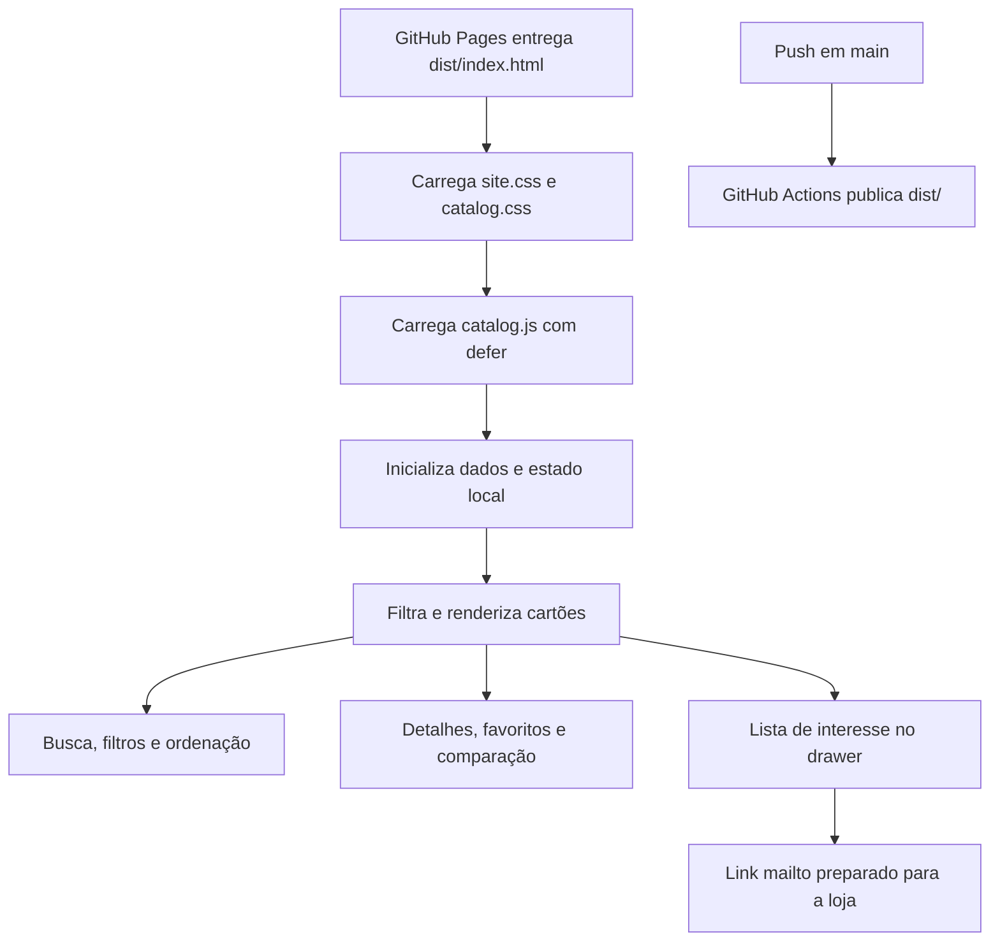

# Arquitetura e estrutura da VÉLO

**Documento técnico** · atualizado em 30/10/2026  
**Escopo documentado:** repositório `oluisvi/velo-mobilidade`, branch `main`.

## Resumo

O site é um **catálogo estático de página única**. HTML, CSS e JavaScript são servidos pelo GitHub Pages; não existe framework, etapa de build, API própria ou banco de dados. O JavaScript monta os cartões e controla busca, filtros, comparação, favoritos, detalhes e lista de interesse.

Essa escolha mantém a demonstração simples de publicar e operar. Ela também limita o que o site pode afirmar: preço, estoque, compra, pagamento e atendimento não são conectados a um sistema comercial.

## Estrutura do repositório

```text
.
├── .github/workflows/pages.yml   # Publicação automática de dist/ no GitHub Pages
├── .openai/hosting.json          # Configuração do projeto Sites apontando para dist/
├── docs/
│   └── ARQUITETURA.md            # Este documento
├── dist/
│   ├── index.html                # Estrutura e conteúdo da página
│   ├── site.css                  # Tokens, composição, responsividade e movimento
│   ├── catalog.css               # Controles e componentes específicos do catálogo
│   └── catalog.js                # Dados e comportamento do catálogo
├── README.md                     # Entrada do projeto e links de documentação
└── VELO.md                       # Briefing de marca e produto
```

## Partes e responsabilidades

### `dist/index.html`

Define o documento em português, metadados, fontes externas, ordem de carregamento dos estilos, estrutura semântica da página e contêineres dos elementos interativos. Carrega `catalog.js` com `defer`.

As seções visíveis são: faixa de anúncio; navegação; hero; faixa editorial em movimento; coleção e filtros; catálogo; linha de confiança; seção de inspeção; categorias; orientação de compra; contato/newsletter; rodapé. Drawer, modal, painel de comparação e toast ficam fora do fluxo principal para funcionar como camadas de interface.

### `dist/site.css`

Concentra tokens de cor e tipografia, layout global, composição editorial, estados de foco, movimento e regras responsivas mobile-first. A composição parte de uma coluna no celular, cresce para duas a partir de 640 px e usa a grade ampla a partir de 900 px. `prefers-reduced-motion` reduz as animações.

### `dist/catalog.css`

Agrupa os estilos de busca, ordenação, seleção de comparação, etiquetas e cartões gerados pelo JavaScript. Separar essa camada permite ajustar o catálogo sem espalhar regras específicas pela composição editorial.

### `dist/catalog.js`

É um módulo fechado por uma IIFE, sem biblioteca de runtime. O arquivo contém o inventário local, taxonomia de categorias, renderização dos cartões, busca, filtros, ordenação, favoritos, comparação, drawer, modal, notificação e persistência local.

### Publicação

`.github/workflows/pages.yml` executa a cada push em `main` ou manualmente. O workflow prepara `dist/` e publica o artefato no GitHub Pages. O endereço público atual é [oluisvi.github.io/velo-mobilidade](https://oluisvi.github.io/velo-mobilidade/). `.openai/hosting.json` também aponta o projeto Sites para a pasta `dist/`.

## Fluxo de execução



## Dados do catálogo

Os produtos estão declarados no array `products` de `catalog.js`. Os campos usados são:

| Campo | Função |
| --- | --- |
| `id` | Identificador estável usado para estados e ações. |
| `name`, `brand` | Nome exibido e fabricante. |
| `type` | Chave de categoria: `bike`, `scooter`, `patinete`, `trike`, `mono` ou `moped`. |
| `use`, `tag` | Contexto de uso e etiqueta curta do cartão. |
| `image` | URL externa da imagem principal. |
| `source` | Página de origem associada aos dados do produto. |
| `description` | Texto de detalhe exibido no modal. |
| `facts` | Três especificações opcionais; alguns modelos ainda não têm dados preenchidos. |
| `factLabels` | Rótulos opcionais para as especificações. |

As categorias e produtos são definidos localmente no JavaScript. Adicionar um produto significa completar os dados disponíveis, validar origem e versão, conferir a imagem e adicionar a fonte correspondente. O fallback de cartão tenta usar a imagem de outro modelo da mesma categoria; isso evita um espaço vazio, mas não substitui a correção da imagem original.

## Estado e comportamento

| Estado | Onde vive | Comportamento |
| --- | --- | --- |
| Categoria ativa, termo de busca e ordenação | Memória durante a sessão | Filtram e reordenam os cartões sem recarregar a página. |
| Modelos salvos | `localStorage`, chave `velo-saved` | Mantém favoritos neste navegador. |
| Lista e quantidade de modelos | `localStorage`, chave `velo-cart` | Mantém a lista de interesse neste navegador; não representa pedido ou reserva. |
| Comparação | Memória durante a sessão | Permite selecionar até três modelos. |
| Modal, drawer e toast | DOM e classes de estado | Apresentam detalhes, lista de interesse e feedback momentâneo. |

O drawer prepara um link `mailto:` com os modelos selecionados. O destino `ola@velo.com.br` é provisório e requer validação. O projeto não envia mensagem por conta própria.

## Decisões de experiência

- A página prioriza navegação e catálogo em uma única rota para reduzir etapas até a exploração.
- A hierarquia editorial coloca a promessa da marca antes dos controles de descoberta.
- Filtros por formato coexistem com busca textual e ordenação por nome.
- Cartões apresentam os dados disponíveis e um caminho para consultar detalhes e fonte.
- Busca, filtro, ordenação, seleção de categoria e ações do cartão funcionam sem hover.
- Imagens e alguns dados técnicos vêm de domínios externos; preços e disponibilidade são indicados como consulta.
- Não foi adicionada uma experiência 3D: imagens estáticas e animações CSS dão escala e movimento sem baixar modelos WebGL nem exigir um caminho alternativo para renderização 3D.

## Acessibilidade e adaptação

- Documento declarado como `pt-BR`; imagens têm texto alternativo.
- Botões de filtro expõem `aria-pressed`; controles de busca e ordenação têm nome acessível.
- O modal e o drawer usam semântica de diálogo, nome e contenção de foco; `Escape` fecha a camada aberta e o foco retorna ao acionador.
- `:focus-visible` desenha indicador de teclado; mensagens usam região `aria-live`.
- Conteúdo não depende de JavaScript para permanecer visível; quando o script inicia, as classes de revelação habilitam os efeitos de entrada.
- Movimento reduzido é respeitado por consulta de preferência do sistema.
- Breakpoints mobile-first: base compacta; `640px` para grade intermediária; `900px` para navegação e composição de desktop.

## Limites atuais e evolução sugerida

### O que existe hoje

- 16 modelos estáticos com imagens externas e detalhes por produto;
- filtros, busca, ordenação, favoritos, comparação e lista de interesse local;
- publicação automática no GitHub Pages.

### O que não existe

- CMS, API, contas, sincronização entre dispositivos, preço, estoque ou reserva;
- checkout, cálculo de frete, pagamentos, pedidos ou CRM;
- captura de e-mail em formulário, analytics ou área de administração.

### Próximos passos antes de operação comercial

1. Confirmar empresa, domínio, canal de atendimento e regiões atendidas.
2. Confirmar imagens, direito de uso, versão e fonte primária de cada produto; considerar servir imagens próprias e otimizadas.
3. Validar especificações, preços, estoque, garantia, entrega e classificação regulatória por mercado.
4. Escolher uma fonte de verdade de catálogo (planilha/CMS/API) se a manutenção manual deixar de ser adequada.
5. Definir backend e integrações antes de adicionar conta, reserva ou pagamento; um catálogo estático não deve simular confirmação comercial.
6. Substituir o `mailto:` de demonstração por um fluxo de contato aprovado e publicar políticas comerciais e de privacidade.

## Manutenção desta arquitetura

O `catalog.js` continua sendo a fonte de verdade dos dados demonstrativos. Este documento descreve fronteiras e comportamento, não deve ser usado como inventário operacional de SKU, preço ou estoque. Se uma mudança introduzir dependências, backend, persistência remota ou checkout, atualizar este documento e o diagrama junto com a implementação.
